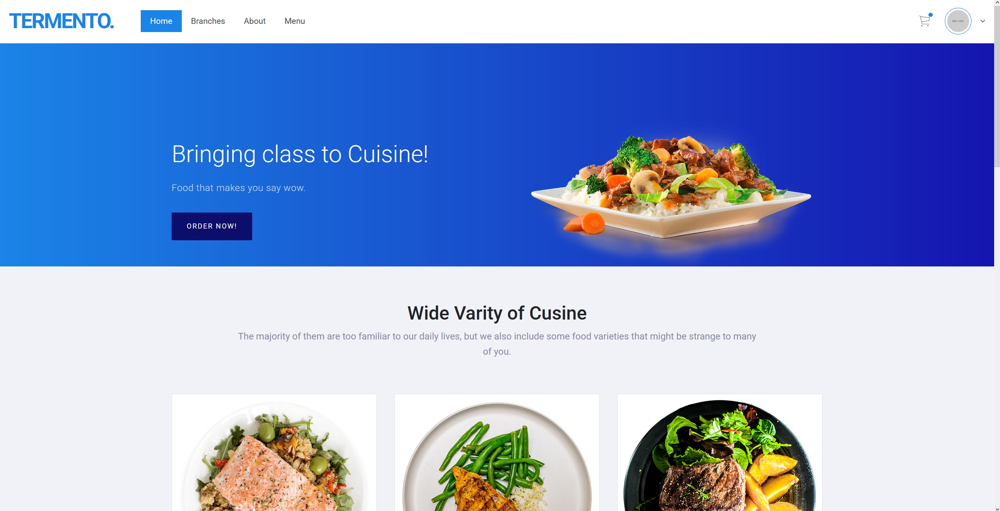
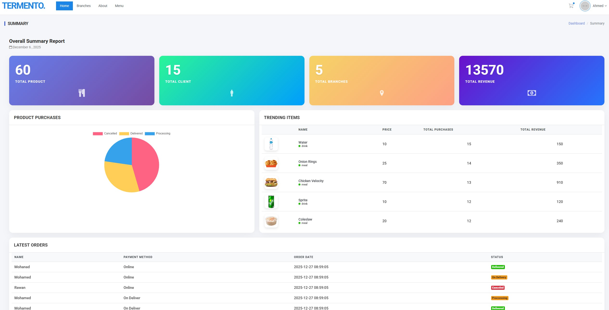
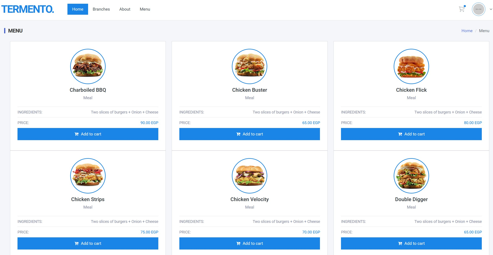

# Tremento Website

A modern, full-stack web application built with React and Node.js. Tremento provides a sleek, responsive user interface with powerful backend functionality for [describe your website's purpose - e.g., e-commerce, social platform, business management, etc.].



## 🌟 Features

### Frontend
- **Modern React UI**: Component-based architecture for maintainability
- **Responsive Design**: Optimized for desktop, tablet, and mobile devices
- **Smooth Animations**: Engaging user experience with transitions
- **State Management**: Efficient data flow and component communication
- **Client-side Routing**: Fast navigation without page reloads
- **Form Validation**: Real-time input validation and error handling

### Backend
- **Node.js Server**: Fast, scalable backend API
- **MySQL Database**: Reliable data storage and management
- **RESTful API**: Clean, organized endpoints
- **Authentication**: Secure user login and session management
- **Data Validation**: Server-side input sanitization
- **Error Handling**: Comprehensive error management

### User Experience
- **Intuitive Navigation**: Easy-to-use interface
- **Fast Load Times**: Optimized performance
- **Accessibility**: WCAG compliant design
- **Cross-browser Support**: Works on all modern browsers

## 📸 Screenshots





## 🚀 Getting Started

### Prerequisites

- **Node.js**: Version 14.x or higher
- **npm**: Version 6.x or higher (comes with Node.js)
- **MySQL**: Version 5.7 or higher
- **Git**: For cloning the repository

### Installation

1. **Clone the repository**
   ```bash
   git clone <your-repo-url>
   cd Tremento_Website
   ```

2. **Set up the database**
   - Start your MySQL server
   - Create a new database:
     ```sql
     CREATE DATABASE tremento;
     ```
   - Import the schema:
     ```bash
     mysql -u root -p tremento < database.sql
     ```

3. **Install server dependencies**
   ```bash
   cd server
   npm install
   ```

4. **Install client dependencies**
   ```bash
   cd ../client
   npm install
   ```

5. **Configure environment variables**
   
   Create `.env` file in the `server` directory:
   ```env
   DB_HOST=localhost
   DB_USER=root
   DB_PASSWORD=your_password
   DB_NAME=tremento
   PORT=5000
   JWT_SECRET=your_secret_key
   ```

6. **Start the development servers**
   
   **Terminal 1 - Backend:**
   ```bash
   cd server
   npm start
   ```
   
   **Terminal 2 - Frontend:**
   ```bash
   cd client
   npm start
   ```

7. **Access the application**
   - Frontend: `http://localhost:3000`
   - Backend API: `http://localhost:5000`

## 📖 Usage Guide

### For Users

1. **Register/Login**
   - Create a new account or login with existing credentials
   - Secure authentication with JWT tokens

2. **Navigate the Platform**
   - Use the navigation menu to access different sections
   - Responsive design adapts to your device

3. **[Add specific features]**
   - Feature 1 description
   - Feature 2 description
   - Feature 3 description

### For Developers

**Running Tests:**
```bash
cd client
npm test
```

**Building for Production:**
```bash
cd client
npm run build
```

**Linting:**
```bash
npm run lint
```

## 🗄️ Database Schema

### Users Table
```sql
CREATE TABLE users (
    id INT PRIMARY KEY AUTO_INCREMENT,
    username VARCHAR(255) UNIQUE NOT NULL,
    email VARCHAR(255) UNIQUE NOT NULL,
    password VARCHAR(255) NOT NULL,
    created_at TIMESTAMP DEFAULT CURRENT_TIMESTAMP,
    updated_at TIMESTAMP DEFAULT CURRENT_TIMESTAMP ON UPDATE CURRENT_TIMESTAMP
);
```

### [Add other tables]
```sql
-- Add your other table schemas here
```

## 🛠️ Technology Stack

### Frontend
- **React 17+**: UI library
- **React Router**: Client-side routing
- **Axios**: HTTP client for API calls
- **CSS3**: Styling and animations
- **[Add other frontend libraries]**

### Backend
- **Node.js**: JavaScript runtime
- **Express.js**: Web application framework
- **MySQL**: Relational database
- **JWT**: Authentication tokens
- **bcrypt**: Password hashing
- **[Add other backend libraries]**

### Development Tools
- **npm**: Package manager
- **Git**: Version control
- **ESLint**: Code linting
- **Prettier**: Code formatting

## 📁 Project Structure

```
Tremento_Website/
├── client/                    # React frontend
│   ├── public/               # Static files
│   ├── src/
│   │   ├── components/       # React components
│   │   ├── pages/           # Page components
│   │   ├── services/        # API services
│   │   ├── utils/           # Utility functions
│   │   ├── App.js           # Main App component
│   │   └── index.js         # Entry point
│   ├── package.json
│   └── README.md
├── server/                   # Node.js backend
│   ├── routes/              # API routes
│   ├── controllers/         # Route controllers
│   ├── models/              # Database models
│   ├── middleware/          # Custom middleware
│   ├── config/              # Configuration files
│   ├── server.js            # Server entry point
│   └── package.json
├── database.sql             # Database schema
├── .gitignore
└── README.md               # This file
```

## 🔒 Security Features

- **Password Hashing**: bcrypt for secure password storage
- **JWT Authentication**: Secure token-based auth
- **Input Validation**: Prevent SQL injection and XSS
- **CORS Configuration**: Controlled cross-origin requests
- **Environment Variables**: Sensitive data protection
- **HTTPS Ready**: SSL/TLS support for production

## 🎨 Customization

### Changing Theme Colors

Edit `client/src/App.css`:
```css
:root {
    --primary-color: #your-color;
    --secondary-color: #your-color;
    --accent-color: #your-color;
}
```

### Adding New API Endpoints

1. Create route in `server/routes/`
2. Implement controller in `server/controllers/`
3. Add route to `server/server.js`

### Adding New React Components

1. Create component in `client/src/components/`
2. Import and use in parent components
3. Add routing if needed in `App.js`

## 📊 API Documentation

### Authentication Endpoints

**POST /api/auth/register**
- Register a new user
- Body: `{ username, email, password }`

**POST /api/auth/login**
- Login existing user
- Body: `{ email, password }`
- Returns: JWT token

### [Add other endpoints]

**GET /api/[resource]**
- Description
- Authentication: Required/Not Required

**POST /api/[resource]**
- Description
- Body: `{ field1, field2 }`

## 🚀 Deployment

### Frontend (Netlify/Vercel)

1. Build the production bundle:
   ```bash
   cd client
   npm run build
   ```

2. Deploy the `build/` directory to your hosting service

### Backend (Heroku/DigitalOcean)

1. Set environment variables on your hosting platform
2. Deploy the `server/` directory
3. Ensure database is accessible

### Database (Cloud)

- Use services like AWS RDS, Google Cloud SQL, or PlanetScale
- Update connection strings in environment variables

## 🐛 Troubleshooting

**Frontend won't start:**
- Delete `node_modules` and `package-lock.json`
- Run `npm install` again
- Check Node.js version

**Backend connection error:**
- Verify MySQL is running
- Check database credentials in `.env`
- Ensure port 5000 is available

**CORS errors:**
- Verify CORS configuration in `server.js`
- Check frontend API URL configuration

## 📝 Future Enhancements

- [ ] Add user profile management
- [ ] Implement real-time notifications
- [ ] Add file upload functionality
- [ ] Integrate payment gateway
- [ ] Add admin dashboard
- [ ] Implement search functionality
- [ ] Add social media integration
- [ ] Mobile app version

## 🧪 Testing

```bash
# Run frontend tests
cd client
npm test

# Run backend tests
cd server
npm test
```

## 📄 License

This project is licensed under the MIT License - see the LICENSE file for details.

## 👥 Contributors

- Your Name - Initial work

## 📧 Contact

For questions, issues, or contributions:
- Email: your.email@example.com
- GitHub: [@yourusername](https://github.com/yourusername)
- Website: [yourwebsite.com](https://yourwebsite.com)

## 🙏 Acknowledgments

- React team for the amazing framework
- Node.js community
- All contributors and supporters

---

**Note**: This project is actively maintained. Feel free to contribute or report issues!
